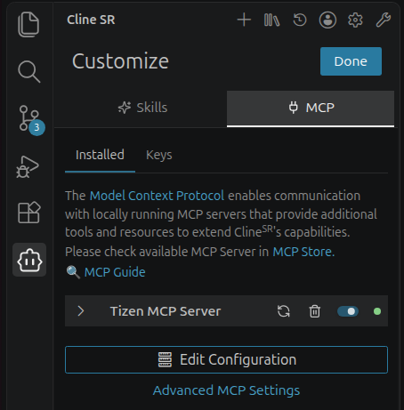

[→ 한국어 문서](https://github.sec.samsung.net/NUI/dali-ui/wiki/AI-Agent-Skills-(kr))

> [!CAUTION]
> This page contains experimental content.

# AI Agent Skills

dali-ui provides several AI Coding Agent skills that assist with development. These skills use **code templates** applicable to specific situations to write customized code, helping you quickly scaffold your app.

 

## Skill List

Please visit [here](https://github.com/dalihub/dali-skills#available-skills) to check the skill list.

 

## Installation

Please visit [here](https://github.com/dalihub/dali-skills#install-a-skill) to see installation commands.

 

## Using Cline with Tizen MCP Server

You can use the Tizen MCP Server with Cline, one of the AI Coding Agents.

Tizen MCP Server provides Tizen and VD API information that Cline can use when helping you write code. Accessing VD resources requires an API key.

MCP (Model Context Protocol) is a standard way for an AI agent to connect to tools and services.

### Install Cline

Follow the [Cline extension installation guide](https://github.sec.samsung.net/CodingAssistant/cline/wiki/Extension-%EC%84%A4%EC%B9%98) to install Cline in VS Code.

 

### 1. Configure the Proxy if Needed

If you are on Samsung's secure network, you may need to configure a proxy in VS Code. See the [Cline MCP guide](https://github.sec.samsung.net/CodingAssistant/cline/wiki/MCP) for instructions.

 

### 2. Add Tizen MCP Server

1. Open the Cline extension in VS Code.
2. Click the **Customize** button (the wrench icon at the top right), then select the **MCP** tab.
3. Click the **MCP Store** link and search for **Tizen MCP Server**.
4. Copy the server's JSON configuration from the Store.
5. Return to Cline's **MCP** tab and click **Edit Configuration** to open `cline_mcp_settings.json`.
6. Add the copied server configuration to the file and save it. If other servers are already configured, keep their entries and add the Tizen MCP Server entry alongside them.

Once added successfully, **Tizen MCP Server** appears in the **Installed** list as shown below.

 

### 3. Try a Prompt

With the dali-ui skill installed and Tizen MCP Server connected, open Cline and enter a prompt such as:

> Write me a dali-ui app that draws a single yellow square.

That's all you need to get started.

 

---

[← Back to list](https://github.sec.samsung.net/NUI/dali-ui/wiki)
