# DALi UI Components - ChartView

[→ 한국어 문서](https://github.sec.samsung.net/NUI/dali-ui/wiki/ChartView-(kr).md)

`ChartView` is a multi-type chart component for `dali-ui-components`. It renders line, bar, pie, area, scatter, and gauge charts using ThorVG-backed `CanvasView` layers, with full support for zoom/pan gestures, interactive tooltips, animated data transitions, and real-time data feeds.

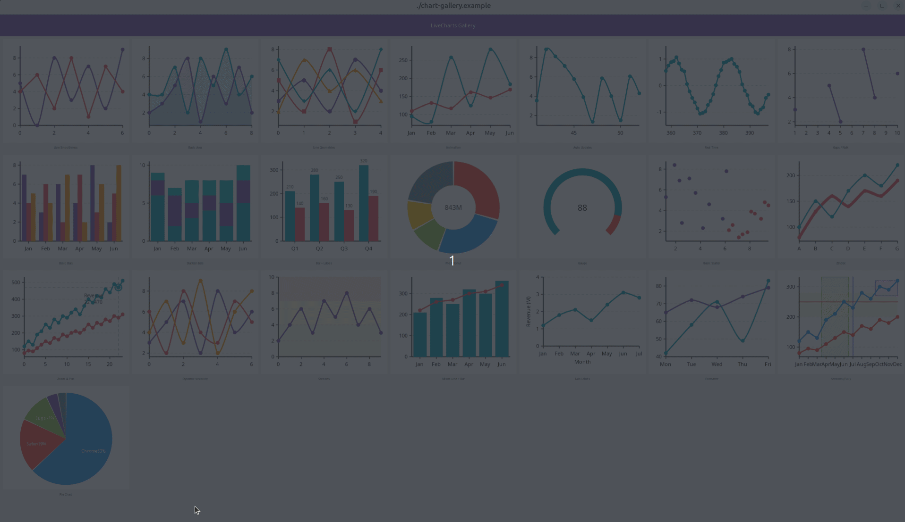

---

## Table of Contents

1. [Basic Setup](#1-basic-setup)
2. [Chart Types](#2-chart-types)
3. [LineSeries](#3-lineseries)
4. [BarSeries](#4-barseries)
5. [PieSeries](#5-pieseries)
6. [ScatterSeries](#6-scatterseries)
7. [ChartAxis](#7-chartaxis)
8. [ChartSection](#8-chartsection)
9. [Properties](#9-properties)
10. [Real-time Updates & Performance](#10-real-time-updates--performance)
11. [Interaction & Zoom/Pan](#11-interaction--zoompan)
12. [Signals](#12-signals)
13. [Animation](#13-animation)
14. [Gauge](#14-gauge)
15. [Layout Integration](#15-layout-integration)
16. [CMake Integration](#16-cmake-integration)
17. [Default Values](#17-default-values)
18. [Important Notes](#18-important-notes)
19. [Standard design gallery](#19-standard-design-gallery)

---

## 1. Basic Setup

> ⚠️ **Note**: `ChartView` is part of `dali-ui-components`. You must call `Components::UiConfig::New().Apply()` before running the application. See [Configuration](Configuration.md) for details.

### main.cpp

```cpp
#include <dali-ui-components/dali-ui-components.h>
#include <dali-ui-foundation/dali-ui-foundation.h>
using namespace Dali;
using namespace Dali::Ui;

int main(int argc, char** argv)
{
  // Apply Components::UiConfig before running the application.
  Components::UiConfig::New().Apply();

  MyApp app(argc, argv); // MyApp inherits tizen_appfw::UiApplication
  return app.Run();
}
```

### Creating a ChartView

```cpp
#include <dali-ui-components/dali-ui-components.h>
#include <dali-ui-foundation/dali-ui-foundation.h>
using namespace Dali;
using namespace Dali::Ui;

// Create a LINE chart with explicit size
ChartView chart = ChartView::New(ChartView::Type::LINE, Vector2(480.0f, 360.0f));

// Configure chart
chart.SetTitle("Monthly Revenue");
ChartAxis xAxis = ChartAxis::New();
xAxis.SetTitle("Month");
xAxis.SetLabels({"Jan", "Feb", "Mar", "Apr", "May", "Jun"});
chart.SetXAxis(xAxis);

ChartAxis yAxis = ChartAxis::New();
yAxis.SetTitle("Amount (USD)");
chart.SetYAxis(yAxis);

LineSeries series = LineSeries::New();
series.SetName("Revenue");
series.SetValues({120.0f, 190.0f, 150.0f, 250.0f, 210.0f, 280.0f});
chart.AddSeries(series);

// Enable grid and legend via properties
chart.SetProperty(ChartView::Property::SHOW_GRID, true);
chart.SetProperty(ChartView::Property::SHOW_LEGEND, true);
```

### Placing in a Layout

```cpp
// Method 1: AbsoluteLayout with AbsoluteLayoutParams
chart.SetLayoutParams(AbsoluteLayoutParams::New()
    .SetX(20.0f).SetY(60.0f)
    .SetWidth(480.0f).SetHeight(360.0f));

AbsoluteLayout root = AbsoluteLayout::New();
root.SetRequestedWidth(MATCH_PARENT);
root.SetRequestedHeight(MATCH_PARENT);
root.Add(chart);
window.Add(root);
```

```cpp
// Method 2: SetRequestedX/Y without a separate layout params object
chart.SetRequestedX(20.0f);
chart.SetRequestedY(60.0f);
window.Add(chart);
```

> 💡 **Tip**: `ChartView` is a standard `View` and participates in the dali-ui layout system. Place it inside an `AbsoluteLayout` when you need pixel-precise positioning.

<br/>

---

## 2. Chart Types

Pass the type to `ChartView::New()`. The type cannot be changed after creation.

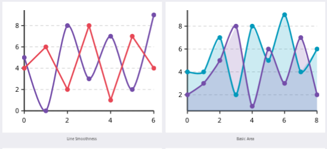

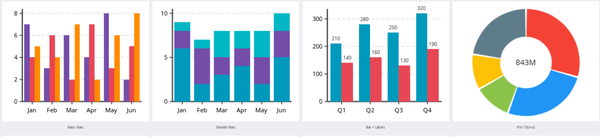

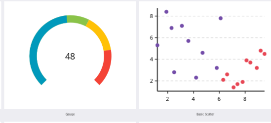

| Type | Enum | Description |
|---|---|---|
| Line | `ChartView::Type::LINE` | Connected line with optional markers |
| Bar | `ChartView::Type::BAR` | Vertical grouped or stacked bars |
| Pie | `ChartView::Type::PIE` | Full-circle pie chart |
| Area | `ChartView::Type::AREA` | Filled area beneath a line (`LineSeries` with `SetFillEnabled(true)`) |
| Scatter | `ChartView::Type::SCATTER` | XY scatter plot with marker shapes |
| Gauge | `ChartView::Type::GAUGE` | Arc-based gauge (no series — uses dedicated Gauge API) |

```cpp
ChartView lineChart    = ChartView::New(ChartView::Type::LINE,    Vector2(480, 360));
ChartView barChart     = ChartView::New(ChartView::Type::BAR,     Vector2(480, 360));
ChartView pieChart     = ChartView::New(ChartView::Type::PIE,     Vector2(400, 400));
ChartView areaChart    = ChartView::New(ChartView::Type::AREA,    Vector2(480, 360));
ChartView scatterChart = ChartView::New(ChartView::Type::SCATTER, Vector2(480, 360));
ChartView gaugeChart   = ChartView::New(ChartView::Type::GAUGE,   Vector2(360, 360));
```

> ⚠️ **Note**: `AREA` is a convenience alias. It behaves identically to `LINE` — you still create `LineSeries` and call `series.SetFillEnabled(true)` to get the filled area appearance. The enum value causes no special internal behavior beyond documentation intent.

<br/>

---

## 3. LineSeries

`LineSeries` renders a connected polyline with optional markers, fill, and data labels.


### Creating and Adding Data

```cpp
chart.AddSeries(LineSeries::New()
    .SetName("Revenue")
    .SetColor(Vector4(0.2f, 0.6f, 1.0f, 1.0f))
    .SetValues({120.0f, 190.0f, 150.0f, 250.0f, 220.0f, 280.0f}));
```

### Line Style

```cpp
series.SetLineWidth(3.0f);          // Line stroke width in pixels
series.SetSmoothness(0.8f);         // 0.0 = straight segments, 1.0 = fully smooth Bezier
```

### Markers

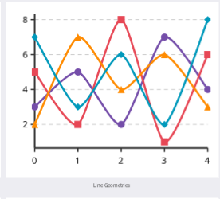

```cpp
series.SetMarkersVisible(true);
series.SetMarkerShape(LineSeries::MarkerShape::CIRCLE);   // CIRCLE, SQUARE, TRIANGLE, DIAMOND
series.SetMarkerRadius(5.0f);
series.SetMarkerColor(Vector4(0.2f, 0.6f, 1.0f, 1.0f));
series.SetMarkerBorderColor(Vector4(1.0f, 1.0f, 1.0f, 1.0f));
series.SetMarkerBorderWidth(1.5f);
```

| `MarkerShape` | Description |
|---|---|
| `CIRCLE` | Filled circle (default) |
| `SQUARE` | Filled square |
| `TRIANGLE` | Upward-pointing triangle |
| `DIAMOND` | Diamond (rotated square) |

### Area (Fill)

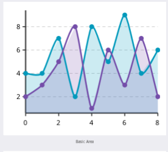

```cpp
// Area chart: enable fill below the line
series.SetFillEnabled(true);
series.SetFillColor(Vector4(0.2f, 0.4f, 0.8f, 0.3f));  // Semi-transparent
```

### Data Labels

```cpp
series.SetDataLabelsVisible(true);
series.SetDataLabelFormat("%.1f");      // printf-style format string
series.SetDataLabelColor(Vector4(0.1f, 0.1f, 0.1f, 1.0f));
series.SetDataLabelSize(9.0f);          // Font size in points

// Or use a custom formatter function
series.SetDataLabelFormatter([](float value, int pointIndex) {
    char buf[32];
    std::snprintf(buf, sizeof(buf), "$%.0f", value);
    return Dali::String(buf);
});
```

### NaN Gap

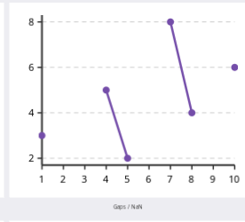

Insert a `NaN` value to break the line (create a visible gap):

```cpp
#include <limits>
float NaN = std::numeric_limits<float>::quiet_NaN();

series.SetValues({100.0f, 150.0f, 120.0f,
                  NaN,              // gap here — line breaks between index 2 and 4
                  200.0f, 180.0f, 220.0f});
```

### Z-Index (Draw Order)

`SetZIndex` is available on all series types (`LineSeries`, `BarSeries`, `ScatterSeries`). Higher value = drawn on top.

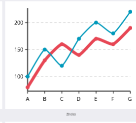

```cpp
series.SetZIndex(10);   // Higher value = drawn on top of lower-z series
```

### Full Example

```cpp
LineSeries sales = LineSeries::New();
sales.SetName("Sales");
sales.SetColor(Vector4(0.2f, 0.6f, 1.0f, 1.0f));
sales.SetValues({50.0f, 80.0f, 60.0f, 100.0f, 70.0f});
sales.SetLineWidth(2.5f);
sales.SetSmoothness(0.5f);
sales.SetMarkersVisible(true);
sales.SetMarkerShape(LineSeries::MarkerShape::DIAMOND);
sales.SetMarkerRadius(5.0f);
sales.SetFillEnabled(true);
sales.SetFillColor(Vector4(0.2f, 0.6f, 1.0f, 0.2f));
sales.SetDataLabelsVisible(true);
sales.SetDataLabelFormat("%.0f");
chart.AddSeries(sales);
```

<br/>

---

## 4. BarSeries

`BarSeries` renders vertical bars. Multiple `BarSeries` added to the same chart are grouped by default; set `SetStacked(true)` to stack them.

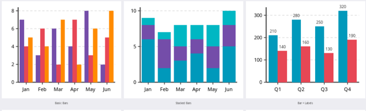

### Basic Bar Chart

```cpp
BarSeries revenue = BarSeries::New();
revenue.SetColor(Vector4(0.39f, 0.58f, 0.93f, 1.0f));
revenue.SetDataLabelsVisible(true);
revenue.SetName("Revenue");
revenue.SetValues({320.0f, 410.0f, 380.0f, 450.0f});
chart.AddSeries(revenue);

BarSeries cost = BarSeries::New();
cost.SetColor(Vector4(1.0f, 0.39f, 0.28f, 1.0f));
cost.SetDataLabelsVisible(true);
cost.SetName("Cost");
cost.SetValues({210.0f, 250.0f, 230.0f, 280.0f});
chart.AddSeries(cost);
```

### Stacked Bars

```cpp
BarSeries base = BarSeries::New();
base.SetColor(Vector4(0.39f, 0.58f, 0.93f, 1.0f));
base.SetStacked(true);
base.SetName("Base");
base.SetValues({200.0f, 240.0f, 220.0f, 270.0f});
chart.AddSeries(base);

BarSeries addon = BarSeries::New();
addon.SetColor(Vector4(0.24f, 0.70f, 0.44f, 1.0f));
addon.SetStacked(true);
addon.SetName("Add-on");
addon.SetValues({80.0f, 110.0f, 90.0f, 130.0f});
chart.AddSeries(addon);
```

> 💡 **Tip**: Stacked and grouped bars can coexist in the same chart. Series with `SetStacked(true)` are accumulated; series with `SetStacked(false)` (the default) occupy their own grouped slot.

### Bar Group Width

```cpp
b1.SetBarGroupWidth(0.6f);   // 0.0–1.0 ratio of the available slot width; default 0.7
```

### Data Labels

```cpp
b1.SetDataLabelsVisible(true);
b1.SetDataLabelFormat("%.0f");
b1.SetDataLabelColor(Vector4(1.0f, 1.0f, 1.0f, 1.0f));
b1.SetDataLabelSize(9.0f);
```

### Mixing BarSeries and LineSeries

`BarSeries` and `LineSeries` can be added to the same `ChartView::Type::LINE` chart. The line is drawn over the bars.

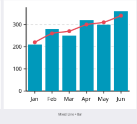

```cpp
ChartView chart = ChartView::New(ChartView::Type::LINE, Vector2(480, 360));

BarSeries bars = BarSeries::New();
bars.SetValues({320.0f, 410.0f, 380.0f, 450.0f});
chart.AddSeries(bars);

LineSeries trend = LineSeries::New();
trend.SetName("Target");
trend.SetValues({380.0f, 400.0f, 400.0f, 420.0f});
trend.SetMarkersVisible(true);
chart.AddSeries(trend);
```

<br/>

---

## 5. PieSeries

`PieSeries` draws a pie chart. Set `SetInnerRadiusRatio()` greater than zero to make it a donut chart.

### Basic Pie Chart

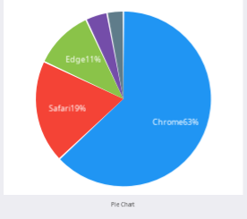

```cpp
ChartView chart = ChartView::New(ChartView::Type::PIE, Vector2(400.0f, 400.0f));
chart.SetTitle("Browser Market Share");
chart.SetProperty(ChartView::Property::SHOW_LEGEND, true);

PieSeries pie = PieSeries::New();
pie.AddSlice("Chrome",  63.0f, Vector4(0.39f, 0.58f, 0.93f, 1.0f));
pie.AddSlice("Safari",  19.0f, Vector4(1.0f,  0.39f, 0.28f, 1.0f));
pie.AddSlice("Edge",    11.0f, Vector4(0.24f, 0.70f, 0.44f, 1.0f));
pie.AddSlice("Firefox",  4.0f, Vector4(0.58f, 0.44f, 0.86f, 1.0f));
pie.AddSlice("Other",    3.0f, Vector4(0.5f,  0.5f,  0.5f,  1.0f));
pie.SetDataLabelsVisible(true);
chart.AddSeries(pie);
```

### Donut Chart

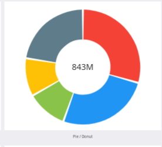

```cpp
PieSeries pie = PieSeries::New();
pie.AddSlice("Asia",    42.0f, Vector4(0.39f, 0.58f, 0.93f, 1.0f));
pie.AddSlice("America", 28.0f, Vector4(1.0f,  0.39f, 0.28f, 1.0f));
pie.AddSlice("Europe",  20.0f, Vector4(0.24f, 0.70f, 0.44f, 1.0f));
pie.AddSlice("Others",  10.0f, Vector4(0.5f,  0.5f,  0.5f,  1.0f));

pie.SetInnerRadiusRatio(0.55f);    // 0.0 = full pie, >0.0 = donut hole
pie.SetCenterLabel("$4.2B");       // Text displayed in the donut hole
pie.SetSliceGap(2.0f);             // Gap between slices in degrees
pie.SetDataLabelsVisible(true);
pie.SetDataLabelMinAngle(15.0f);   // Hide label if slice angle is smaller than this
chart.AddSeries(pie);
```

### Slice Management

```cpp
pie.ClearSlices();
int count = pie.GetSliceCount();
```

<br/>

---

## 6. ScatterSeries

`ScatterSeries` plots XY coordinate pairs as individual markers with no connecting lines.

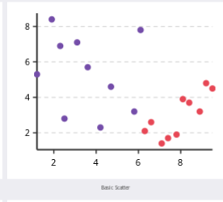

### XY Data

```cpp
ChartView chart = ChartView::New(ChartView::Type::SCATTER, Vector2(480.0f, 360.0f));
chart.SetProperty(ChartView::Property::SHOW_GRID, true);
chart.SetProperty(ChartView::Property::SHOW_LEGEND, true);

// SetValues takes a vector of (x, y) pairs
ScatterSeries groupA = ScatterSeries::New();
groupA.SetName("Group A");
groupA.SetColor(Vector4(0.39f, 0.58f, 0.93f, 1.0f));
groupA.SetMarkerShape(ScatterSeries::MarkerShape::CIRCLE);
groupA.SetMarkerRadius(7.0f);
groupA.SetValues({{0.5f, 30.0f}, {1.8f, 55.0f}, {3.2f, 45.0f}, {4.1f, 80.0f}});
chart.AddSeries(groupA);

ScatterSeries groupB = ScatterSeries::New();
groupB.SetName("Group B");
groupB.SetColor(Vector4(1.0f, 0.39f, 0.28f, 1.0f));
groupB.SetMarkerShape(ScatterSeries::MarkerShape::DIAMOND);
groupB.SetMarkerRadius(10.0f);
groupB.SetValues({{1.0f, 70.0f}, {2.5f, 40.0f}, {3.8f, 90.0f}, {5.0f, 25.0f}});
chart.AddSeries(groupB);
```

| `MarkerShape` | Description |
|---|---|
| `CIRCLE` | Filled circle |
| `SQUARE` | Filled square |
| `TRIANGLE` | Upward-pointing triangle |
| `DIAMOND` | Diamond |

> 💡 **Tip**: Mix `ScatterSeries` with `LineSeries` in the same chart to overlay a trend line on scatter data.

<br/>

---

## 7. ChartAxis

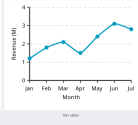

`ChartAxis` controls labels, title, limits, grid styling, and tick step for the X or Y axis.

### Labels and Title

```cpp
ChartAxis xAxis = ChartAxis::New();
xAxis.SetTitle("Quarter");
xAxis.SetLabels({"Q1", "Q2", "Q3", "Q4"});
chart.SetXAxis(xAxis);

ChartAxis yAxis = ChartAxis::New();
yAxis.SetTitle("Revenue (USD)");
chart.SetYAxis(yAxis);
```

### Manual Range Limits

```cpp
yAxis.SetMinimumLimit(0.0f);
yAxis.SetMaximumLimit(500.0f);
```

When limits are not set, the axis auto-ranges to fit the data (plus padding).

### Data Padding

Adds extra space beyond the data range as a fraction of the total range:

```cpp
yAxis.SetDataPadding(0.1f);   // 10% headroom above the maximum value
xAxis.SetDataPadding(0.0f);   // No padding on the X axis
```

### Minimum Tick Step

Forces tick marks to land on multiples of the given value:

```cpp
yAxis.SetMinimumStep(50.0f);   // Y ticks at 0, 50, 100, 150, ...
```

### Label Rotation

Rotate axis labels to prevent overlap with dense data:

```cpp
xAxis.SetLabelsRotation(45.0f);   // 45-degree rotation
```

### Label and Tick Visibility

Axis labels and tick marks are controlled independently. Hiding labels or skipping overlapping X-axis labels keeps tick marks enabled when `SetTickMarksVisible(true)` is set. This applies to both near and far axis positions; marks outside the viewport are not drawn.

```cpp
xAxis.SetLabelsVisible(false);
xAxis.SetTickMarksVisible(true); // Keep ticks while hiding their text.
```

### Grid and Axis Line Style

```cpp
yAxis.SetGridColor(Vector4(0.0f, 0.5f, 1.0f, 0.6f));
yAxis.SetGridDash(4.0f, 4.0f);             // Dashed grid: 4px dash, 4px gap
yAxis.SetAxisLineColor(Vector4(0.2f, 0.2f, 0.2f, 1.0f));
yAxis.SetAxisLineWidth(2.0f);
```

### Full Example

```cpp
ChartAxis xAxis = ChartAxis::New();
xAxis.SetTitle("Month");
xAxis.SetLabels({"January", "February", "March", "April", "May", "June"});
xAxis.SetLabelsRotation(45.0f);
xAxis.SetDataPadding(0.0f);
chart.SetXAxis(xAxis);

ChartAxis yAxis = ChartAxis::New();
yAxis.SetTitle("Units Sold");
yAxis.SetMinimumStep(50.0f);
yAxis.SetDataPadding(0.1f);
chart.SetYAxis(yAxis);
```

<br/>

---

## 8. ChartSection

`ChartSection` overlays a highlighted region on the chart plot area. Coordinates are in data space (same units as axis values).

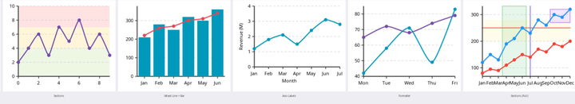

### Section Types

The type is determined by which boundaries are set:

| Pattern | Result |
|---|---|
| `SetXMin` + `SetXMax` only | Vertical band spanning full Y range |
| `SetYMin` + `SetYMax` only | Horizontal band spanning full X range |
| `SetXMin == SetXMax` | Vertical threshold line |
| `SetYMin == SetYMax` | Horizontal threshold line |
| All four boundaries set | Rectangle region |

A boundary value of `NaN` means "extend to the plot area edge" on that side.

### Vertical Band (X range highlight)

```cpp
ChartSection xBand = ChartSection::New();
xBand.SetMinimumX(2.5f);
xBand.SetMaximumX(5.5f);
xBand.SetFillColor(Vector4(0.2f, 0.7f, 0.3f, 0.12f));
xBand.SetStrokeColor(Vector4(0.2f, 0.7f, 0.3f, 0.5f));
xBand.SetStrokeWidth(1.5f);
chart.AddSection(xBand);
```

### Horizontal Band (Y range highlight)

```cpp
ChartSection yBand = ChartSection::New();
yBand.SetMinimumY(200.0f);
yBand.SetMaximumY(280.0f);
yBand.SetFillColor(Vector4(1.0f, 0.85f, 0.2f, 0.10f));
chart.AddSection(yBand);
```

### Horizontal Threshold Line

```cpp
ChartSection hLine = ChartSection::New();
hLine.SetMinimumY(250.0f);
hLine.SetMaximumY(250.0f);   // same value = line
hLine.SetStrokeColor(Vector4(1.0f, 0.3f, 0.3f, 0.9f));
hLine.SetStrokeWidth(2.0f);
chart.AddSection(hLine);
```

### Vertical Reference Line

```cpp
ChartSection vLine = ChartSection::New();
vLine.SetMinimumX(6.0f);
vLine.SetMaximumX(6.0f);   // same value = line
vLine.SetStrokeColor(Vector4(0.4f, 0.4f, 1.0f, 0.8f));
vLine.SetStrokeWidth(2.0f);
chart.AddSection(vLine);
```

### Rectangle Region

```cpp
ChartSection rect = ChartSection::New();
rect.SetMinimumX(8.5f);
rect.SetMaximumX(11.5f);
rect.SetMinimumY(270.0f);
rect.SetMaximumY(320.0f);
rect.SetFillColor(Vector4(0.6f, 0.2f, 1.0f, 0.12f));
rect.SetStrokeColor(Vector4(0.6f, 0.2f, 1.0f, 0.6f));
rect.SetStrokeWidth(1.5f);
chart.AddSection(rect);
```

### Section Management

```cpp
chart.RemoveSection(xBand);
chart.ClearSections();
```

<br/>

---

## 9. Properties

Use `chart.SetProperty(ChartView::Property::PROPERTY_NAME, value)` to configure chart-wide appearance and behavior.

| Property | Type | Default | Description |
|---|---|---|---|
| `SHOW_GRID` | `bool` | `true` | Show grid lines |
| `SHOW_LEGEND` | `bool` | `true` | Show series legend |
| `SHOW_TOOLTIP` | `bool` | `true` | Show data-point tooltip on hover/touch |
| `BACKGROUND_COLOR` | `Vector4` | white `(1,1,1,1)` | Chart background color |
| `GRID_COLOR` | `Vector4` | `(0.9,0.9,0.9,1)` | Grid line color |
| `ANIMATION_DURATION` | `float` (ms) | `0.0` | Data-change animation duration (0 = disabled) |
| `Y_AXIS_AUTO_RANGE` | `bool` | `true` | Auto-fit Y axis to data range |
| `LEGEND_POSITION` | `int` | `1` (TOP) | Legend position: 0=NONE, 1=TOP, 2=BOTTOM, 3=LEFT, 4=RIGHT |
| `AXIS_LABEL_SIZE` | `float` | `11.0` | Axis tick label font size in points |
| `TITLE_SIZE` | `float` | `16.0` | Chart title font size in points |
| `LINE_WIDTH` | `float` | `2.5` | Default line width for all series (can be overridden per series) |
| `SHOW_MARKERS` | `bool` | `true` | Global toggle for marker visibility |
| `MARKER_RADIUS` | `float` | `4.0` | Default marker radius (can be overridden per series) |
| `HOVER_ENABLED` | `bool` | `true` | Enable hover (pointer/stylus) interaction |
| `TOUCH_ENABLED` | `bool` | `true` | Enable touch (finger) interaction |

```cpp
chart.SetProperty(ChartView::Property::SHOW_GRID,        true);
chart.SetProperty(ChartView::Property::SHOW_LEGEND,      true);
chart.SetProperty(ChartView::Property::SHOW_TOOLTIP,     true);
chart.SetProperty(ChartView::Property::BACKGROUND_COLOR, Vector4(0.98f, 0.98f, 0.98f, 1.0f));
chart.SetProperty(ChartView::Property::GRID_COLOR,       Vector4(0.85f, 0.85f, 0.85f, 1.0f));
chart.SetProperty(ChartView::Property::ANIMATION_DURATION, 300.0f);
chart.SetProperty(ChartView::Property::AXIS_LABEL_SIZE,  10.0f);
chart.SetProperty(ChartView::Property::TITLE_SIZE,       14.0f);
chart.SetProperty(ChartView::Property::TOUCH_ENABLED,    true);
chart.SetProperty(ChartView::Property::HOVER_ENABLED,    false);
```

### Title Position

```cpp
chart.SetTitle("Sales Dashboard");
chart.SetTitlePosition(ChartView::TitlePosition::TOP_LEFT);   // TOP_CENTER (default), TOP_LEFT, TOP_RIGHT, BOTTOM_CENTER
chart.SetTitleColor(Vector4(0.1f, 0.1f, 0.1f, 1.0f));
```

### Series Management

```cpp
chart.AddSeries(series);
chart.RemoveSeries("Revenue");   // Remove by name
chart.RemoveAllSeries();
```

<br/>

---

## 10. Real-time Updates & Performance

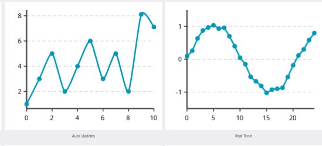

### Sliding Window with AppendValue

For real-time data feeds (sensors, streaming), use `AppendValue()` together with `SetMaximumDataPoints()` to maintain a fixed-length sliding window:

```cpp
LineSeries series = LineSeries::New();
series.SetName("CPU Usage");
series.SetMaximumDataPoints(60);   // Keep at most 60 points; oldest discarded on overflow

chart.AddSeries(series);

// In a timer callback or event handler:
series.AppendValue(newY);          // Appends one Y value; auto-increments X index
```

### Batch Append

```cpp
// Seed with initial values
series.AppendValues({30.0f, 55.0f, 40.0f, 80.0f, 60.0f});
```

### Update Throttle

`SetUpdateThrottle()` limits how often a data change triggers a redraw. The default is `16 ms` (~60 fps). For high-frequency data sources this prevents excessive rasterization:

```cpp
// Redraw at most once per 100 ms (10 fps) — useful for very fast sensors
chart.SetUpdateThrottle(100.0f);

// Disable throttling: redraw immediately on every AppendValue
chart.SetUpdateThrottle(0.0f);
```

### Full Real-time Example

```cpp
// Keep a reference to call AppendValue later
LineSeries liveSeries = LineSeries::New();
liveSeries.SetName("Temperature");
liveSeries.SetColor(Vector4(1.0f, 0.4f, 0.2f, 1.0f));
liveSeries.SetMaximumDataPoints(120);
liveSeries.SetMarkersVisible(false);

chart.AddSeries(liveSeries);
chart.SetUpdateThrottle(50.0f);   // At most 20 redraws per second

// Every 50 ms in your application loop:
liveSeries.AppendValue(readSensorTemperature());
```

<br/>

---

## 11. Interaction & Zoom/Pan

### Zoom Mode

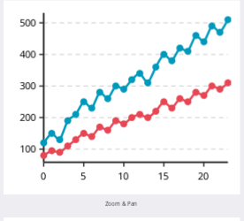

`SetZoomMode()` accepts a bitmask of `ChartView::ZoomMode` flags:

| Flag | Value | Description |
|---|---|---|
| `NONE` | `0` | No zoom or pan |
| `PAN_X` | `1 << 0` | Pan along the X axis |
| `PAN_Y` | `1 << 1` | Pan along the Y axis |
| `ZOOM_X` | `1 << 2` | Pinch-zoom on the X axis |
| `ZOOM_Y` | `1 << 3` | Pinch-zoom on the Y axis |

```cpp
// Enable X pan and X zoom (common stock-chart pattern)
chart.SetZoomMode(
    static_cast<int>(ChartView::ZoomMode::PAN_X) |
    static_cast<int>(ChartView::ZoomMode::ZOOM_X));

// Enable full 2D pan and zoom
chart.SetZoomMode(
    static_cast<int>(ChartView::ZoomMode::PAN_X)  |
    static_cast<int>(ChartView::ZoomMode::PAN_Y)  |
    static_cast<int>(ChartView::ZoomMode::ZOOM_X) |
    static_cast<int>(ChartView::ZoomMode::ZOOM_Y));

// Disable all interaction
chart.SetZoomMode(static_cast<int>(ChartView::ZoomMode::NONE));
```

### Zoom Helpers

```cpp
chart.SetZoomClampEnabled(true);    // Prevent panning beyond the data range
chart.SetAutoFitYOnPanEnabled(true);       // Auto-scale Y axis to the visible X window while panning
chart.ResetZoom();                  // Return to the full data view
```

### Tooltip Finding Strategy

Controls which data points are highlighted when the user hovers or taps:

| Strategy | Description |
|---|---|
| `NEAREST` | Nearest single point across all series (default) |
| `SAME_X` | All points sharing the same X index across all series |
| `SAME_X_NEAREST_Y` | All points at the same X with the nearest Y |

```cpp
chart.SetFindingStrategy(ChartView::FindingStrategy::SAME_X);
```

### Custom Tooltip Formatter

```cpp
chart.SetTooltipFormatter([](const Dali::String& seriesName,
                              const Dali::String& xLabel,
                              float               dataY) {
    char buf[64];
    std::snprintf(buf, sizeof(buf), "[%s] %s: $%.0f",
                  seriesName.CStr(), xLabel.CStr(), dataY);
    return Dali::String(buf);
});
```

### Legend Toggle

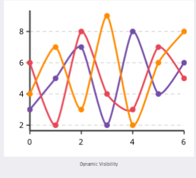

When enabled, tapping a legend entry hides or shows the corresponding series:

```cpp
chart.SetLegendToggleEnabled(true);    // Default: true
chart.SetLegendToggleEnabled(false);   // Signal-only mode: LegendItemTappedSignal fires but visibility does not change
```

### Hit Threshold

```cpp
chart.SetHitThreshold(30.0f);   // Distance in pixels within which a tap is considered a hit (default 30)
```

<br/>

---

## 12. Signals

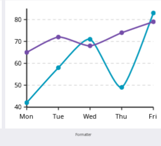

Every ChartView signal's first callback argument is the `ChartView` that emitted it — useful when one handler is connected to several charts.

### DataPointSelectedSignal

Emitted when the user taps or hovers over a data point.

```cpp
class MyHandler : public Dali::ConnectionTracker
{
public:
    void OnPointSelected(ChartView chart, const ChartPointEventArgs& e)
    {
        // e.GetSeriesIndex()  — zero-based series index
        // e.GetPointIndex()   — zero-based point index within the series
        // e.GetDataX()        — X value of the selected point
        // e.GetDataY()        — Y value of the selected point
        // e.GetSeriesName()   — name set via SetName()
        // e.GetXLabel()       — label string from ChartAxis::SetLabels()
        DALI_LOG_RELEASE_INFO("Hit series %d, point %d: [%s] = %.1f\n",
                              e.GetSeriesIndex(), e.GetPointIndex(),
                              e.GetXLabel().CStr(), e.GetDataY());
    }
};

MyHandler handler;
chart.DataPointSelectedSignal().Connect(&handler, &MyHandler::OnPointSelected);
```

### LegendItemTappedSignal

Emitted when the user taps a legend entry.

```cpp
void OnLegendTapped(ChartView chart, int seriesIndex, bool isNowVisible)
{
    DALI_LOG_RELEASE_INFO("Legend series %d toggled -> %s\n",
                          seriesIndex, isNowVisible ? "visible" : "hidden");
}

chart.LegendItemTappedSignal().Connect(&handler, &MyHandler::OnLegendTapped);
```

### MultiPointSelectedSignal

Emitted for each matching point when `FindingStrategy::SAME_X` or `SAME_X_NEAREST_Y` is active. The signal fires once per matching point with the same `ChartPointEventArgs` layout as `DataPointSelectedSignal`.

```cpp
chart.SetFindingStrategy(ChartView::FindingStrategy::SAME_X);
chart.MultiPointSelectedSignal().Connect(&handler, &MyHandler::OnMultiPoint);
```

### ZoomedSignal

Emitted after a zoom or pan gesture completes, reporting the new viewport in data coordinates as a `Dali::Bounds` (x = minimum X, y = minimum Y, `Right()`/`Bottom()` give the maximum X/Y).

```cpp
void OnZoomed(ChartView chart, const Dali::Bounds& vp)
{
    // vp.x, vp.Right() — visible X range in data coordinates
    // vp.y, vp.Bottom() — visible Y range in data coordinates
    DALI_LOG_RELEASE_INFO("Viewport X[%.1f ~ %.1f] Y[%.1f ~ %.1f]\n",
                          vp.x, vp.Right(), vp.y, vp.Bottom());
}

chart.ZoomedSignal().Connect(&handler, &MyHandler::OnZoomed);
```

### Signal Summary

| Signal | Callback Signature | Emitted When |
|---|---|---|
| `DataPointSelectedSignal` | `void(ChartView, const ChartPointEventArgs&)` | Single point tapped or hovered |
| `LegendItemTappedSignal` | `void(ChartView, int index, bool isVisible)` | Legend entry tapped |
| `MultiPointSelectedSignal` | `void(ChartView, const ChartPointEventArgs&)` | Each matching point under SAME_X strategy |
| `ZoomedSignal` | `void(ChartView, const Dali::Bounds&)` | Zoom or pan gesture ends |

<br/>

---

## 13. Animation

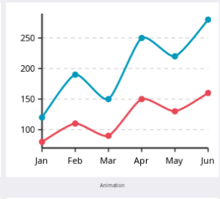

`ChartView` can animate transitions when data is updated via `SetValues()`.

### Enabling Animation

```cpp
chart.SetAnimationDuration(300.0f);                              // 300 ms
chart.SetAnimationEasing(ChartView::EasingType::EASE_OUT);       // Easing function
```

| `EasingType` | Description |
|---|---|
| `LINEAR` | Constant speed throughout |
| `EASE_OUT` | Fast start, decelerates at the end (natural-feeling) |
| `EASE_IN_OUT` | Slow start, fast middle, slow end (smooth) |

### Animation Example

```cpp
chart.SetAnimationDuration(300.0f);
chart.SetAnimationEasing(ChartView::EasingType::EASE_OUT);

// The next SetValues() call will animate the transition
series.SetValues({60.0f, 40.0f, 280.0f, 100.0f, 310.0f, 180.0f});
```

> ⚠️ **Note**: `ANIMATION_DURATION` property and `SetAnimationDuration()` control the same setting. Setting `ANIMATION_DURATION` to `0.0` (the default) disables animation.

<br/>

---

## 14. Gauge

The `GAUGE` chart type renders a circular arc gauge. It does **not** use `AddSeries()` — all configuration is done through dedicated gauge methods on `ChartView`.

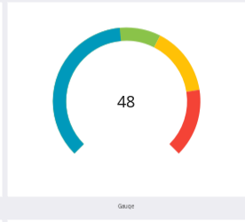

### Basic Gauge

```cpp
ChartView gauge = ChartView::New(ChartView::Type::GAUGE, Vector2(360.0f, 360.0f));
gauge.SetTitle("CPU Usage");

gauge.SetGaugeMinimumValue(0.0f);
gauge.SetGaugeMaximumValue(100.0f);
gauge.SetGaugeValue(72.0f);        // Current needle position

// Color zones
gauge.AddGaugeRange( 0.0f,  60.0f, Vector4(0.24f, 0.70f, 0.44f, 1.0f));  // green
gauge.AddGaugeRange(60.0f,  80.0f, Vector4(1.0f,  0.7f,  0.0f,  1.0f));  // yellow
gauge.AddGaugeRange(80.0f, 100.0f, Vector4(1.0f,  0.39f, 0.28f, 1.0f));  // red
```

### Arc Shape

```cpp
gauge.SetGaugeArcSpan(270.0f);         // Total arc angle in degrees (default 270)
gauge.SetGaugeStartAngle(135.0f);      // Angle where arc begins (default 135, 6 o'clock = 270)
gauge.SetGaugeArcWidth(0.18f);         // Arc width as fraction of radius (default 0.18)
```

### Colors

```cpp
gauge.SetGaugeTrackColor(Vector4(0.85f, 0.85f, 0.85f, 1.0f));     // Background arc color
gauge.SetGaugeProgressColor(Vector4(0.27f, 0.51f, 0.71f, 1.0f));  // Progress arc color (overridden by ranges)
```

> 💡 **Tip**: `SetGaugeProgressColor()` sets the default progress color. When `AddGaugeRange()` entries are present, each range segment uses its own color and `SetGaugeProgressColor()` is ignored.

### Center Label

```cpp
gauge.SetGaugeCenterLabel("72%");
```

### Updating the Value

```cpp
// Update in response to events (e.g., a timer or sensor callback)
gauge.SetGaugeValue(newValue);
```

### Range Management

```cpp
gauge.ClearGaugeRanges();
gauge.AddGaugeRange(0.0f, 50.0f, Vector4(0.2f, 0.8f, 0.4f, 1.0f));
gauge.AddGaugeRange(50.0f, 100.0f, Vector4(1.0f, 0.3f, 0.3f, 1.0f));
```

### Gauge API Summary

| Method | Description |
|---|---|
| `SetGaugeValue(float)` | Set the current gauge position |
| `SetGaugeMinimumValue(float)` | Set the minimum range value |
| `SetGaugeMaximumValue(float)` | Set the maximum range value |
| `SetGaugeArcSpan(float)` | Total arc sweep angle in degrees |
| `SetGaugeStartAngle(float)` | Starting angle of the arc |
| `SetGaugeArcWidth(float)` | Arc thickness as a fraction of the radius |
| `SetGaugeTrackColor(Vector4)` | Background track color |
| `SetGaugeProgressColor(Vector4)` | Default progress color |
| `SetGaugeCenterLabel(String)` | Text to display in the center |
| `AddGaugeRange(float, float, Vector4)` | Add a color-coded value range |
| `ClearGaugeRanges()` | Remove all color ranges |

<br/>

---

## 15. Layout Integration

`ChartView` inherits from `View` and integrates fully with the dali-ui layout system.

### Placing with AbsoluteLayout

```cpp
ChartView chart = ChartView::New(ChartView::Type::LINE, Vector2(480.0f, 360.0f));

// Position and size via AbsoluteLayoutParams
chart.SetLayoutParams(AbsoluteLayoutParams::New()
    .SetX(50.0f)
    .SetY(100.0f)
    .SetWidth(480.0f)
    .SetHeight(360.0f));

AbsoluteLayout root = AbsoluteLayout::New();
root.SetRequestedWidth(MATCH_PARENT);
root.SetRequestedHeight(MATCH_PARENT);
root.Add(chart);
window.Add(root);
```

### Position Only (Size from New)

```cpp
// Size is fixed by ChartView::New(); only position needs setting
chart.SetRequestedX(50.0f);
chart.SetRequestedY(100.0f);
window.Add(chart);
```

### Centering in the Window

```cpp
float winW = window.GetSize().width;
float winH = window.GetSize().height;
float chartW = 480.0f, chartH = 360.0f;

chart.SetLayoutParams(AbsoluteLayoutParams::New()
    .SetX((winW - chartW) * 0.5f)
    .SetY((winH - chartH) * 0.5f)
    .SetWidth(chartW)
    .SetHeight(chartH));
```

### Dynamic Resize

Call `SetLayoutParams()` with a new size and re-add the chart to the layout to trigger `OnArrange`:

```cpp
chart.SetLayoutParams(AbsoluteLayoutParams::New()
    .SetX(x).SetY(y).SetWidth(newW).SetHeight(newH));
rootLayout.Remove(chart);
rootLayout.Add(chart);
```

<br/>

---

## 16. CMake Integration

Add the following to your `CMakeLists.txt`:

```cmake
cmake_minimum_required(VERSION 3.8.2)
project(my-chart-app)
set(CMAKE_CXX_STANDARD 17)

find_package(PkgConfig REQUIRED)
pkg_check_modules(DALICORE           REQUIRED dali2-core)
pkg_check_modules(DALIADAPTOR        REQUIRED dali2-adaptor)
pkg_check_modules(DALI_UI_FOUNDATION REQUIRED dali2-ui-foundation)
pkg_check_modules(DALI_UI_COMP       REQUIRED dali2-ui-components)

add_executable(my-chart-app main.cpp)

target_include_directories(my-chart-app PRIVATE
    ${DALICORE_INCLUDE_DIRS}
    ${DALIADAPTOR_INCLUDE_DIRS}
    ${DALI_UI_FOUNDATION_INCLUDE_DIRS}
    ${DALI_UI_COMP_INCLUDE_DIRS}
)

target_link_libraries(my-chart-app
    ${DALICORE_LIBRARIES}
    ${DALIADAPTOR_LIBRARIES}
    ${DALI_UI_FOUNDATION_LIBRARIES}
    ${DALI_UI_COMP_LIBRARIES}
)

target_compile_options(my-chart-app PRIVATE
    ${DALI_UI_COMP_CFLAGS_OTHER}
)
```

> 💡 **Tip**: The sample `samples/chart-view/CMakeLists.txt` shows a complete working build configuration including debug/release flags and `HIDE_DALI_INTERNALS`.

<br/>

---

## 17. Default Values

### ChartView (StyleConfig defaults)

| Setting | Default |
|---|---|
| `SHOW_GRID` | `true` |
| `SHOW_LEGEND` | `true` |
| `SHOW_TOOLTIP` | `true` |
| `SHOW_MARKERS` | `true` |
| `BACKGROUND_COLOR` | white `(1.0, 1.0, 1.0, 1.0)` |
| `GRID_COLOR` | `(0.9, 0.9, 0.9, 1.0)` |
| `AXIS_LABEL_SIZE` | `11.0` pt |
| `TITLE_SIZE` | `16.0` pt |
| `LINE_WIDTH` | `2.5` px |
| `MARKER_RADIUS` | `4.0` px |
| `TOUCH_ENABLED` | `true` |
| `HOVER_ENABLED` | `true` |
| `ANIMATION_DURATION` | `0.0` ms (disabled) |
| `ANIMATION_EASING` | `EASE_OUT` |
| `LEGEND_POSITION` | `TOP` |
| `TITLE_POSITION` | `TOP_CENTER` |
| Legend toggle enabled | `true` |
| Hit threshold | `30.0` px |
| Finding strategy | `NEAREST` |
| Zoom mode | `NONE` |
| Zoom clamp enabled | `true` |
| Auto-fit Y on pan | `false` |
| Update throttle | `16.0` ms |

### Gauge Defaults

| Setting | Default |
|---|---|
| `GaugeMinValue` | `0.0` |
| `GaugeMaxValue` | `100.0` |
| `GaugeValue` | `0.0` |
| `GaugeArcSpan` | `270.0` degrees |
| `GaugeStartAngle` | `135.0` degrees |
| `GaugeArcWidth` | `0.18` (18% of radius) |
| `GaugeTrackColor` | `(0.85, 0.85, 0.85, 1.0)` |
| `GaugeProgressColor` | `(0.27, 0.51, 0.71, 1.0)` |

### Series Defaults

| Setting | Default |
|---|---|
| `LineSeries::LineWidth` | uses `ChartView::LINE_WIDTH` property |
| `LineSeries::Smoothness` | `0.0` (straight segments) |
| `LineSeries::FillEnabled` | `false` |
| `LineSeries::MarkerShape` | `CIRCLE` |
| `BarSeries::Stacked` | `false` |
| `BarSeries::BarGroupWidth` | `0.7` |
| `PieSeries::InnerRadiusRatio` | `0.0` (full pie, no donut hole) |
| `PieSeries::SliceGap` | `0.0` degrees |
| `ChartAxis::DataPadding` | `0.0` (Y axis auto-adds 5% internally) |
| `ChartAxis::MinStep` | `0.0` (auto-step) |

<br/>

---

## 18. Important Notes

- **`Components::UiConfig` is required.** Call `Components::UiConfig::New().Apply()` before running the application when using `dali-ui-components`. See [Configuration](Configuration.md).

- **Chart type is fixed at creation.** `ChartView::New(type, size)` determines the chart type for the lifetime of the object. There is no `SetType()` method — create a new `ChartView` if you need a different type.

- **`AREA` type uses `LineSeries` with fill.** `ChartView::Type::AREA` is a convenience alias. You must still create `LineSeries` and call `SetFillEnabled(true)` on each series to get the filled appearance. The type enum itself does not automatically enable fill.

- **NaN values create line gaps.** In `LineSeries`, inserting `std::numeric_limits<float>::quiet_NaN()` at any index breaks the polyline at that position. The gap applies to both the line and marker rendering. NaN points are skipped in hit testing.

- **`Gauge` type does not use `AddSeries()`.** `ChartView::Type::GAUGE` uses a dedicated set of `SetGauge*()` and `AddGaugeRange()` methods. Calling `AddSeries()` on a GAUGE chart has no effect.

- **`ChartSection` NaN boundaries.** Setting `SetXMin(NaN)` or `SetXMax(NaN)` extends the section to the left or right edge of the plot area respectively. The same applies to `SetYMin(NaN)` / `SetYMax(NaN)`.

- **Layout placement.** `ChartView` must be added to the dali-ui layout tree so that `OnArrange` is called with the correct bounds. For floating or overlay charts, use `AbsoluteLayout` with `AbsoluteLayoutParams` to control position and size precisely.

- **`SetUpdateThrottle(0.0f)` for immediate redraws.** The default throttle of `16 ms` batches rapid data changes into at most one redraw per frame. Use `0.0f` only when you need sub-frame immediacy; otherwise the default is appropriate for most use cases.

- **`SetFindingStrategy(SAME_X)` fires `MultiPointSelectedSignal`.** When using `SAME_X` or `SAME_X_NEAREST_Y`, the `MultiPointSelectedSignal` fires once for each matching point. `DataPointSelectedSignal` still fires for the closest single point independently.

- **`SetLegendToggleEnabled(false)` is signal-only mode.** The `LegendItemTappedSignal` still fires when this is `false`, but `ChartView` will not automatically hide or show the corresponding series. This lets you implement custom toggle logic in your callback.

<br/>

---

## 19. Standard design gallery

The standard gallery contains 141 cards in 20 categories: 137 web reference cards plus native donut, pie, gauge and scatter examples.

These PNGs were captured from the running gallery on Ubuntu on 2026-10-22. The recipes show core chart configuration; use each run command for the complete card, controls and datasets. They distinguish existing Vector4 APIs from new UiColor APIs. Apply Components::UiConfig first as described in Basic Setup.

### Shared colors and style

UiColor supports fixed RGBA values and theme color IDs. New chart APIs retain tokens and redraw after color-table changes. For example, pass `UiColor::ON_SURFACE` to SetLabelColor. Runtime properties take precedence over construction defaults.

```cpp
#include <dali-ui-components/dali-ui-components.h>
#include <dali-ui-foundation/dali-ui-foundation.h>
using namespace Dali;
using namespace Dali::Ui;

ChartView MakeGalleryChart(ChartView::Type type)
{
  auto style = ChartViewStyle::Builder()
    .SetBackgroundColor(UiColor(0xFFFFFFu))
    .SetLabelColor(UiColor(0x777777u))
    .SetLegendTextColor(UiColor(0x777777u))
    .SetTooltipBackgroundColor(UiColor(0xE8F2FFu))
    .SetTooltipTextColor(UiColor(0x222222u))
    .SetPadding(8.0f).Build();
  auto chart = ChartView::New(type, Vector2(618.0f, 300.0f), style);
  chart.SetAnimationDuration(500.0f);
  chart.SetProperty(ChartView::Property::SHOW_LEGEND, false);
  return chart;
}
```

### Per-point Forecast bars

```cpp
auto chart = MakeGalleryChart(ChartView::Type::BAR);
auto bars = BarSeries::New();
bars.SetValues({50.0f, 50.0f, 70.0f, 70.0f, 40.0f, 40.0f, 30.0f, 30.0f});
bars.SetCornerRadius(100.0f);
bars.SetBarGroupWidth(0.5f);
for(uint32_t index = 0u; index < 8u; ++index)
{
  const bool main = index < 4u;
  const bool forecast = index == 2u || index == 3u || index >= 6u;
  const UiColor color(main ? 0x387AFFu : 0xB7B7BBu);
  bars.SetPointColor(index, forecast ? color.WithAlpha(0.3f) : color);
  if(forecast)
  {
    bars.SetPointBorder(index, 1.0f, color, 2.0f, 2.0f);
  }
}
chart.AddSeries(bars);
```

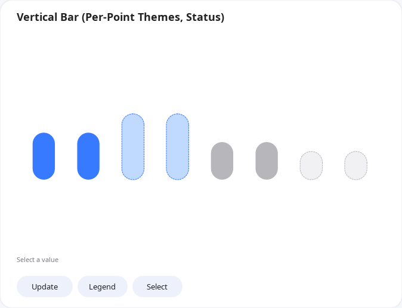

Point fills and borders are independent. Update changes status colors and bar heights while retaining Forecast outlines.

```bash
./samples/chart-view/bin/chart-standard-gallery.example --case=vertical-bar-27
```

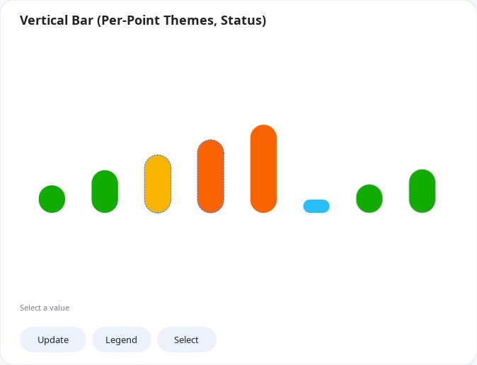

Press Update to transition to new values over the configured 500ms.

### Aligned Highlight threshold

```cpp
auto chart = MakeGalleryChart(ChartView::Type::BAR);
auto bars = BarSeries::New();
bars.SetValues({80.0f, 100.0f});
bars.SetCornerRadius(8.0f);
bars.SetFillThreshold(50.0f, UiColor(0xC5D8FFu), UiColor(0x387AFFu));
chart.AddSeries(bars);
auto guide = ChartSection::New();
guide.SetMinimumY(50.0f);
guide.SetMaximumY(50.0f);
guide.SetStrokeColor(Vector4(0.0f, 0.0f, 0.0f, 1.0f));
guide.SetStrokeWidth(2.0f);
chart.AddSection(guide);
```

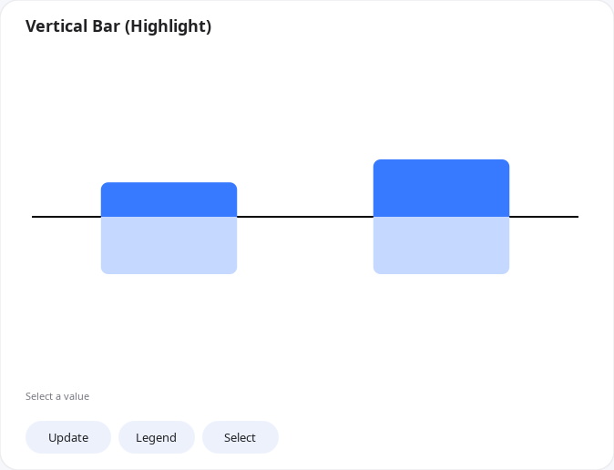

Use the same Y data value for the fill threshold and guide. Both follow the same scale when the size or values change.

```bash
./samples/chart-view/bin/chart-standard-gallery.example --case=vertical-bar-15
```

### Gradient line and area

```cpp
auto chart = MakeGalleryChart(ChartView::Type::LINE);
auto line = LineSeries::New();
line.SetValues({5.0f, 6.0f, 7.0f, 4.0f, 2.0f, 3.0f, 6.0f, 5.0f, 7.0f});
line.SetColor(Vector4(0.22f, 0.48f, 1.0f, 1.0f));
line.SetMarkersVisible(true);
line.SetFillEnabled(true);
Dali::Ui::Gradient::Linear fill(Vector2(0.0f, -0.5f), Vector2(0.0f, 0.5f));
fill.SetStopNodes({Dali::Ui::Gradient::StopNode(0.0f, UiColor(0x0000FFu)),
                   Dali::Ui::Gradient::StopNode(1.0f, UiColor(0xFFFFFFu))});
line.SetFillGradient(fill);
chart.AddSeries(line);
```

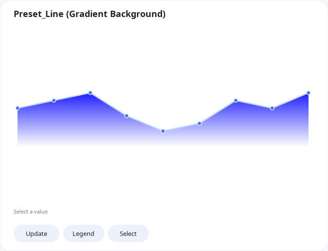

A gradient fills the area below the line. Update moves the line and markers; selecting a point displays a tooltip.

```bash
./samples/chart-view/bin/chart-standard-gallery.example --case=line-12
```

### Colored bars and line

```cpp
auto chart = MakeGalleryChart(ChartView::Type::BAR);
auto bars = BarSeries::New();
bars.SetValues({30.0f, 60.0f, 90.0f, 120.0f, 150.0f});
bars.SetCornerRadius(8.0f);
bars.SetPointColor(0u, UiColor(0x0000FFu));
bars.SetPointColor(1u, UiColor(0x00AA00u));
bars.SetPointColor(2u, UiColor(0xFFAA00u));
auto line = LineSeries::New();
line.SetValues({20.0f, 80.0f, 50.0f, 130.0f, 100.0f});
line.SetColor(Vector4(0.65f, 0.8f, 0.9f, 1.0f));
chart.AddSeries(bars);
chart.AddSeries(line);
chart.SetFindingStrategy(ChartView::FindingStrategy::SAME_X);
```

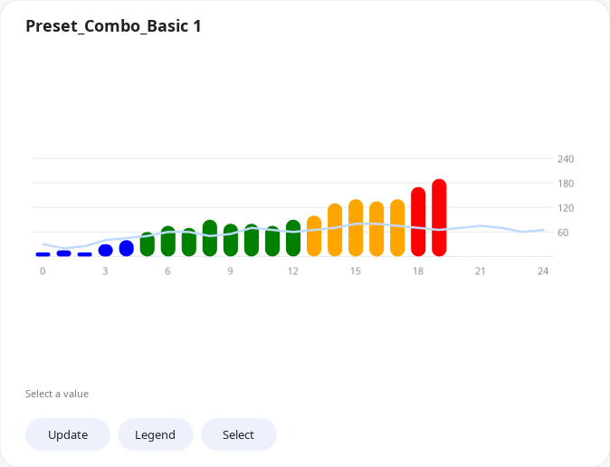

Add bars and a line to the same ChartView. This recipe uses short data; the captured full sample contains 20 bars and 25 line points.

```bash
./samples/chart-view/bin/chart-standard-gallery.example --case=combo-01
```

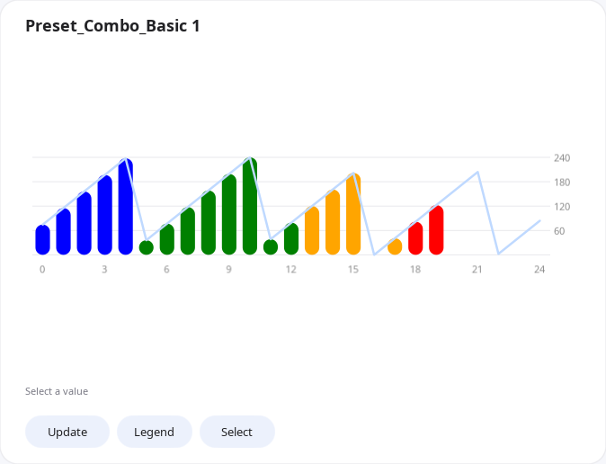

Press Update to transition to new values over the configured 500ms.

### Three-panel energy report

```cpp
auto report = AbsoluteLayout::New();
for(uint32_t row = 0u; row < 3u; ++row)
{
  auto chart = MakeGalleryChart(ChartView::Type::BAR);
  chart.SetLayoutParams(AbsoluteLayoutParams::New()
    .SetX(190.5f).SetY(134.0f + static_cast<float>(row) * 160.0f)
    .SetWidth(304.0f).SetHeight(row == 2u ? 108.0f : 73.0f));
  auto bars = BarSeries::New();
  bars.SetValues({10.0f, 20.0f, 15.0f, 30.0f, 12.0f, 24.0f});
  bars.SetCornerRadius(4.0f);
  chart.AddSeries(bars);
  report.Add(chart);
}
```

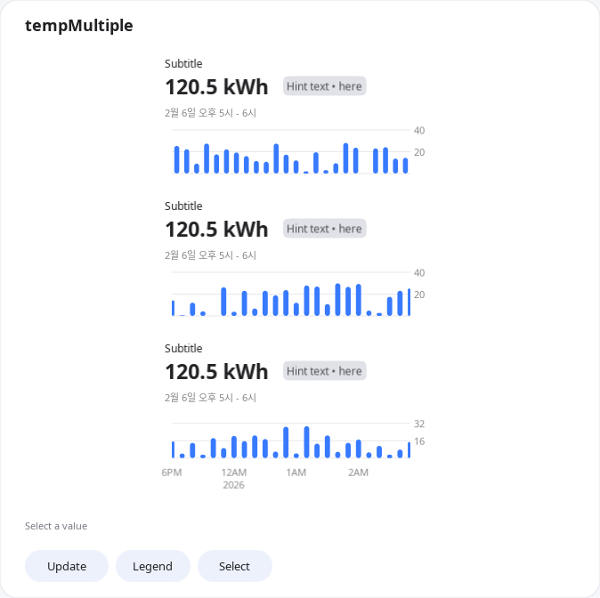

Place three independent ChartViews in one card. This recipe shows chart placement; the full sample supplies 24 values per plot and separate labels for metrics, dates and hints.

```bash
./samples/chart-view/bin/chart-standard-gallery.example --case=pattern-14
```

### Donut distribution

```cpp
auto chart = MakeGalleryChart(ChartView::Type::PIE);
auto pie = PieSeries::New();
pie.SetInnerRadiusRatio(0.62f);
pie.SetSliceGap(2.0f);
pie.AddSlice("Apple", 248.0f, Vector4(UiColor(0x387AFFu)));
pie.AddSlice("Samsung", 220.0f, Vector4(UiColor(0x12AB88u)));
pie.AddSlice("Huawei", 95.0f, Vector4(UiColor(0xFF9A3Du)));
pie.AddSlice("Xiaomi", 90.0f, Vector4(UiColor(0x9B81F6u)));
pie.AddSlice("Others", 190.0f, Vector4(UiColor(0xA3A9B6u)));
chart.AddSeries(pie);
```

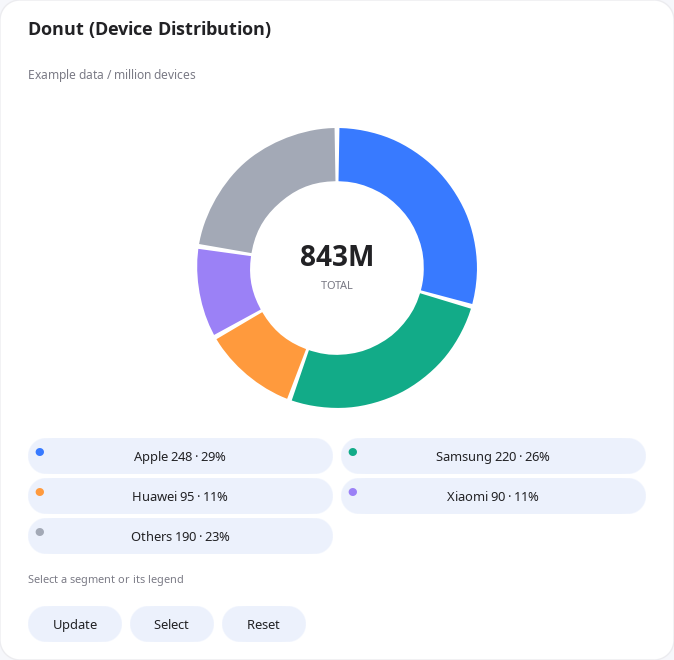

The sample places the 843M total in a separate center label. Slices and legends select segments; Update changes shares and total, and Reset restores the example data.

```bash
./samples/chart-view/bin/chart-standard-gallery.example --case=donut-01
```

Dark theme:

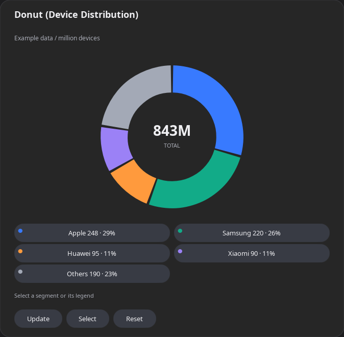

```bash
./samples/chart-view/bin/chart-standard-gallery.example --case=donut-01 --theme=dark
```

### Pie distribution

```cpp
auto chart = MakeGalleryChart(ChartView::Type::PIE);
auto pie = PieSeries::New();
pie.SetInnerRadiusRatio(0.0f);
pie.SetSliceGap(2.0f);
pie.AddSlice("Chrome", 63.0f, Vector4(UiColor(0x387AFFu)));
pie.AddSlice("Safari", 19.0f, Vector4(UiColor(0x12AB88u)));
pie.AddSlice("Edge", 11.0f, Vector4(UiColor(0xFF9A3Du)));
pie.AddSlice("Firefox", 4.0f, Vector4(UiColor(0x9B81F6u)));
pie.AddSlice("Other", 3.0f, Vector4(UiColor(0xA3A9B6u)));
chart.AddSeries(pie);
```

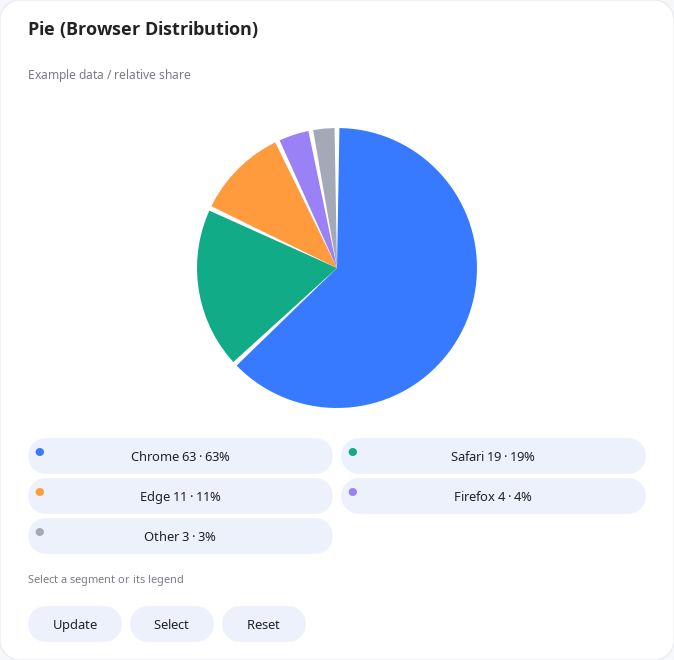

An inner-radius ratio of zero produces a filled pie. Legends show values and shares; gaps between slices are excluded from selection.

```bash
./samples/chart-view/bin/chart-standard-gallery.example --case=pie-01
```

### Activity-goal gauge

```cpp
auto chart = MakeGalleryChart(ChartView::Type::GAUGE);
chart.SetGaugeMinimumValue(0.0f);
chart.SetGaugeMaximumValue(100.0f);
chart.SetGaugeArcSpan(270.0f);
chart.SetGaugeStartAngle(135.0f);
chart.SetGaugeArcWidth(0.18f);
chart.AddGaugeRange(0.0f, 60.0f, Vector4(UiColor(0x78ACFFu)));
chart.AddGaugeRange(60.0f, 80.0f, Vector4(UiColor(0x70CDB5u)));
chart.AddGaugeRange(80.0f, 100.0f, Vector4(UiColor(0xFFB877u)));
chart.SetGaugeValue(72.0f);
chart.SetGaugeCenterLabel("72%");
```

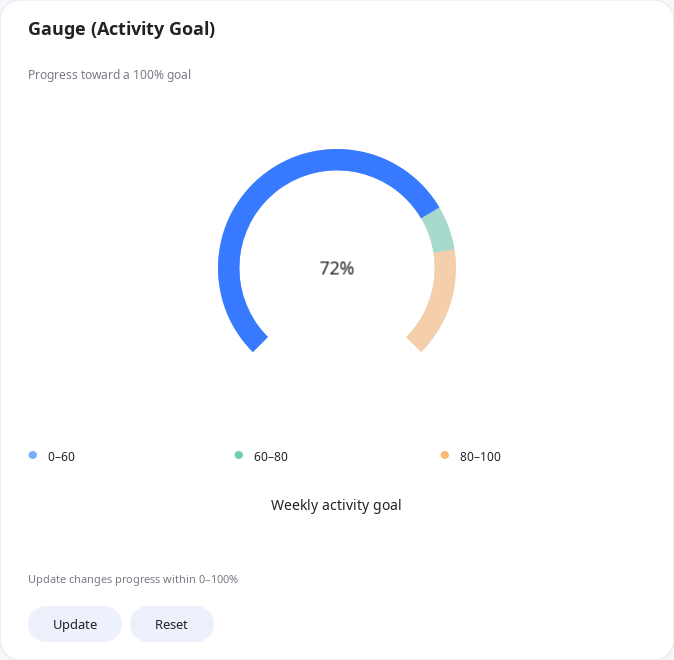

Configure a gauge through ChartView's gauge APIs without adding a series. Update changes progress and Reset restores 72%.

```bash
./samples/chart-view/bin/chart-standard-gallery.example --case=gauge-01
```

### Two-group scatter

```cpp
auto chart = MakeGalleryChart(ChartView::Type::SCATTER);
chart.SetViewport(Vector4(0.0f, 0.0f, 10.0f, 10.0f));
auto first = ScatterSeries::New();
first.SetValues({Vector2(1.2f, 5.3f), Vector2(2.5f, 2.8f), Vector2(3.1f, 7.1f)});
first.SetMarkerShape(ScatterSeries::MarkerShape::CIRCLE);
first.SetColor(Vector4(UiColor(0x387AFFu)));
auto second = ScatterSeries::New();
second.SetValues({Vector2(7.1f, 1.4f), Vector2(8.4f, 3.7f), Vector2(6.3f, 2.1f)});
second.SetMarkerShape(ScatterSeries::MarkerShape::DIAMOND);
second.SetColor(Vector4(UiColor(0xFF7F20u)));
chart.AddSeries(first);
chart.AddSeries(second);
```

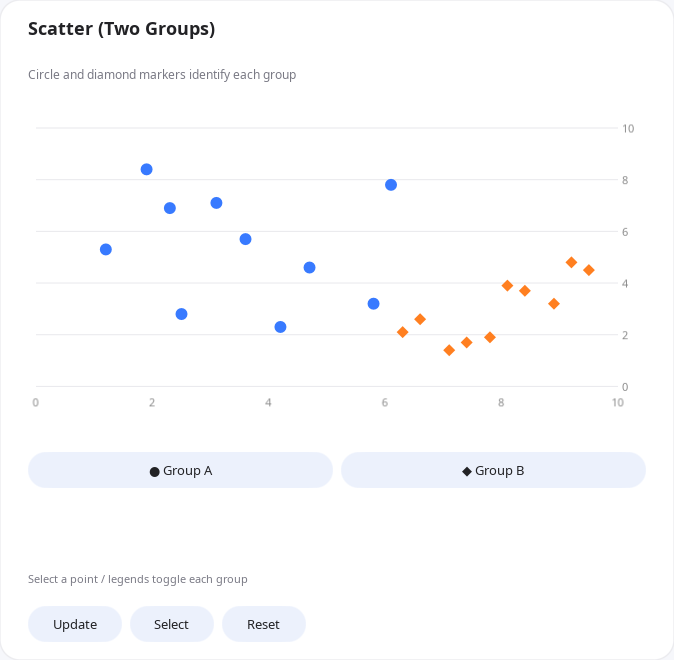

Use independent XY values with circle and diamond markers. This recipe uses three points per group; the full sample uses ten. Legend buttons toggle each group independently.

```bash
./samples/chart-view/bin/chart-standard-gallery.example --case=scatter-01
```

### Complete source and interaction

See [CasePresenter](../samples/chart-view/chart-case-presenter.cpp) for Cartesian charts, annotations and paging; [additional presenters](../samples/chart-view/chart-additional-presenter.cpp) for circular charts and scatter; and the [reference](../samples/chart-view/chart-reference-cases.cpp) and [additional fixtures](../samples/chart-view/chart-additional-cases.cpp) for complete datasets and placement.

Update changes data and Select moves selection. Use Dark/Light to switch themes. Select pie or donut slices through the plot or legend; scatter legends toggle groups. Pie, donut and scatter data updates are immediate; bar and line transitions are animated.

### Content readiness and annotation text

`ContentUpdatedSignal()` is emitted outside layout traversal after a batch has updated
coordinates and labels. Animated changes emit it after their final update. A handler
may restore a visible data-point selection; mutations in the handler schedule another
update. This signal does not guarantee GPU presentation completion.

```cpp
ConnectionTracker tracker; // Keep this alive while receiving callbacks.
chart.ContentUpdatedSignal().Connect(&tracker, [](ChartView ready)
{
  ready.SelectPoint(0u, 1u);
});

auto note = ChartAnnotation::New(ChartAnnotation::Type::TEXT);
note.SetText("A label that can exceed the available width");
note.SetPosition(Vector2(1.0f, 20.0f));
note.SetTextMaximumWidth(90.0f);
note.SetTextOverflowMode(Text::OverflowMode::ELLIPSIS);
chart.AddAnnotation(note);
```

Text width must be finite and non-negative; zero keeps automatic chart-relative
sizing. Overflow supports `CLIP` (default) and `ELLIPSIS`. Chart-relative bounds
still apply when an authored limit is larger than the available chart width.

The gallery stores state separately from card views, restores selection after content
updates, and implements revolving, counting and cross-fading numbers in the sample.
`--list-cases`, `--case=<id>`, `--theme=dark`, `--freeze-animations`, and
`--dump-state=<path>` support inspection. `samples/chart-view/verify-gallery.py`
captures both themes on X11; a capture is evidence for review, not a visual PASS.


### Bar transitions and value-based fills

Bar values and explicit X/Y viewport updates use the configured animation duration.
Each frame interpolates the last displayed bar bounds, including range and stacked
bars. An update during a transition starts from the displayed frame; duration zero
keeps immediate updates. Initial display remains immediate.

`BarSeries::SetBorderDash(dash, gap)` sets a dashed outline when both finite lengths
are positive; `GetBorderDash()` returns the pair. `SetFillThreshold(value, lower,
upper)` places a hard color boundary at a Y data value. Use the same value for a
ChartSection guide to keep them aligned through updates and resizing. Threshold
and gradient fills replace each other; `ClearFillThreshold()` restores solid fill.

`SetPointBorder(index, width, color, dash, gap)` overrides a single bar's complete
border while leaving its fill unchanged. For example, use
`series.SetPointBorder(1u, 1.0f, Color::BLUE, 2.0f, 2.0f)` for a forecast among solid
bars. Width zero hides that border; a zero dash or gap makes it solid. Finite,
non-negative lengths are required. Overrides remain at their data indices through
replacement; future indices can be configured. `ClearPointBorder(index)` and
`ClearPointBorders()` restore the current series border for one or all points.
Point fill colors and point borders are cleared independently. The Per-Point
Themes gallery cases 25–27 use explicit point borders for their Forecast bars.

---

[← Back to Components](Components.md)
