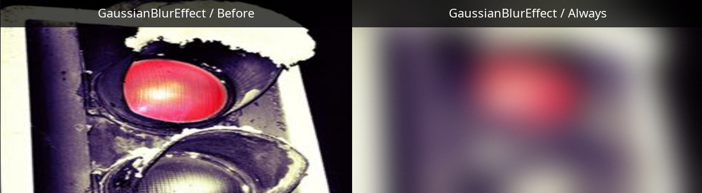
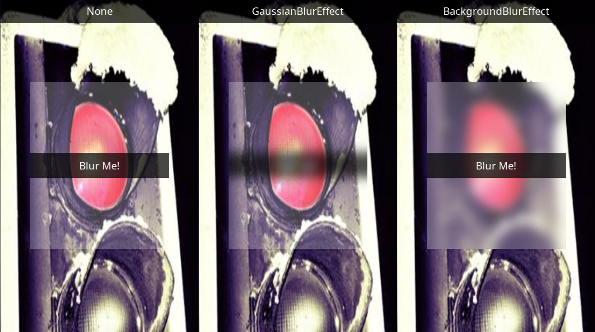
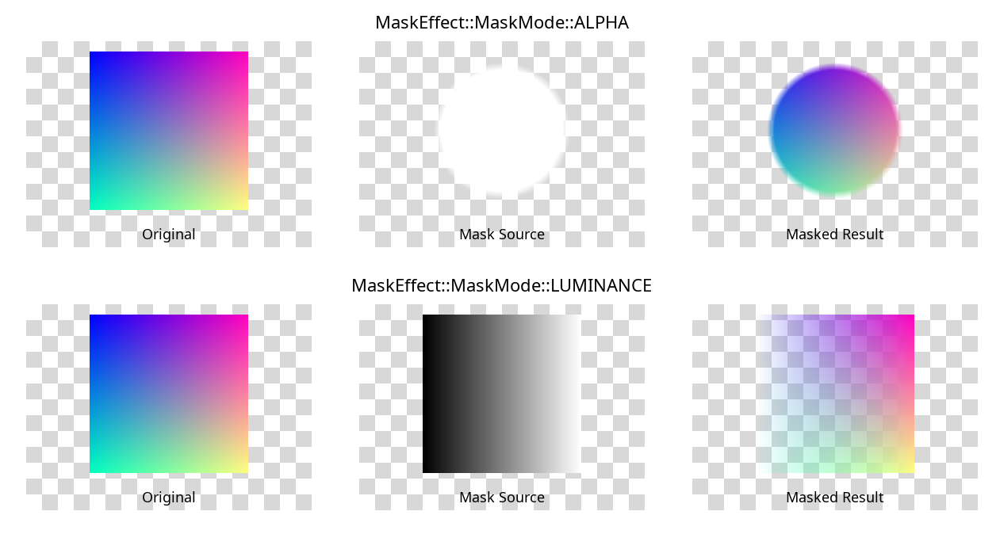
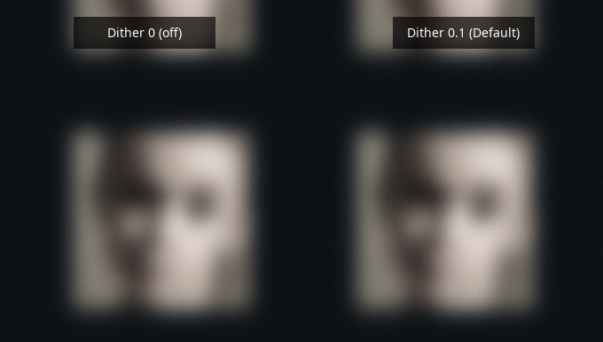
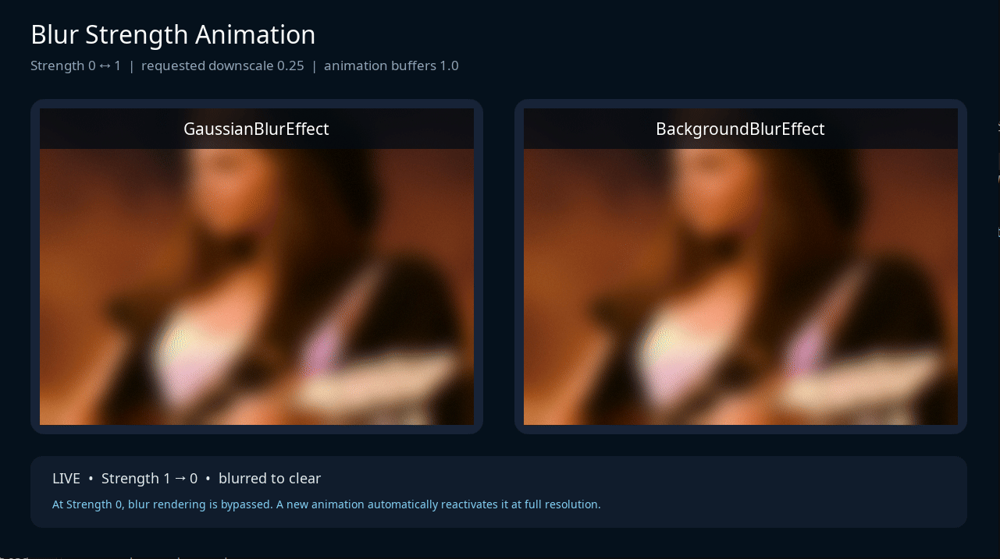

[→ 한국어 문서](https://github.sec.samsung.net/NUI/dali-ui/wiki/Render-Effect-(kr))

# Render Effect

`RenderEffect` is an interface for applying visual effects such as blur and masking to a View. Create the effect you need, then assign it with `View::SetRenderEffect()`.

dali-ui provides the following effects.

| Effect | Target |
| --- | --- |
| `GaussianBlurEffect` | Blurs the View itself and its children. |
| `BackgroundBlurEffect` | Blurs the View's background. |
| `MaskEffect` | Masks the View using another View as the mask source. |

Create a concrete effect object with the corresponding class's `New()` method. Default construction of `RenderEffect` alone does not create a usable effect.

<br/>

## Basic Usage

### Creating and Applying an Effect

The following example applies Gaussian Blur to an existing `view` whose content is ready to display.

```cpp
#include <dali-ui-foundation/public-api/render-effects/gaussian-blur-effect.h>
#include <dali-ui-foundation/public-api/views/view.h>

using namespace Dali::Ui;

// view is an existing View with content ready to display.
GaussianBlurEffect effect = GaussianBlurEffect::New();
view.SetRenderEffect(effect);
```

`SetRenderEffect()` also handles activation, so you do not need to call `Activate()` separately. Activation is deferred while the View is off-scene, invisible, or has zero size. The effect activates automatically once the View can be displayed.

<br/>

### Removing an Effect

Call `ClearRenderEffect()` to remove the effect from the View. Removal also deactivates the effect.

```cpp
view.ClearRenderEffect();
```

To turn an effect off temporarily while keeping it assigned to the View, use `Deactivate()`. Use `Activate()` to turn it back on.

```cpp
effect.Deactivate();

// Activate it again on the same View when needed.
effect.Activate();
```

The effect must be assigned to a View before calling `Activate()`. After removing it with `ClearRenderEffect()`, assign it again with `SetRenderEffect()` to reuse it.

<br/>

### Effect Ownership

Each effect instance can be assigned to only one View at a time. Assigning the same effect to another View moves it to the new View, leaving the previous View without an effect.

```cpp
GaussianBlurEffect effect = GaussianBlurEffect::New();

firstView.SetRenderEffect(effect);
secondView.SetRenderEffect(effect); // Moves from firstView to secondView.
```

To apply effects to multiple Views at the same time, create a separate effect instance for each View. Copying a handle still refers to the same underlying object and does not create a separate instance.

<br/>

## Gaussian Blur

`GaussianBlurEffect` blurs the owner View and its children together. It can be applied to an image or to a View containing multiple children.

```cpp
// Include gaussian-blur-effect.h.
// contentView is a View whose content is ready to display.
GaussianBlurEffect blur = GaussianBlurEffect::New(40u);
blur.SetBlurOnce(false);
contentView.SetRenderEffect(blur);
```

`New(40u)` sets the blur radius to 40. Calling `New()` without arguments also uses a default radius of 40. `SetBlurOnce(false)` refreshes the blur every frame as the content changes.

<!-- Add image: assets/RenderEffect/gaussian-blur-comparison.png
Capture the same content before/after applying the effect, side by side. Include child text
or shapes to show that the View and its children are blurred together. Use radius 40 and continuous refresh.
-->


*Figure 1. Before (left) and after (right) applying Gaussian Blur. The View's content and children are blurred together.*

<br/>

## Background Blur

`BackgroundBlurEffect` blurs the background of its owner View. Gaussian Blur targets the View itself and its children; Background Blur targets the content behind the View.

```cpp
#include <dali-ui-foundation/public-api/render-effects/background-blur-effect.h>

// blurPane is a View placed in front of the background content.
BackgroundBlurEffect blur = BackgroundBlurEffect::New(40u);
blur.SetBlurOnce(false);
blurPane.SetRenderEffect(blur);
```

The View tree affects which content is included in the background. Use `SetSourceView()` and `SetStopperView()` to specify capture boundaries.

```cpp
// backgroundRoot is an ancestor of blurPane.
// stopperView is an existing View marking where capture should stop.
blur.SetSourceView(backgroundRoot);
blur.SetStopperView(stopperView);
```

| Setting | Behavior |
| --- | --- |
| `SetSourceView(view)` | Restricts background capture to the specified ancestor's subtree. Ignored if the View is not an ancestor of the owner. |
| `SetStopperView(view)` | Stops capture when traversal reaches the specified View. That View and content drawn after it are excluded. |
| Pass an empty `View()` | Removes the corresponding restriction and restores its default capture range. |

Without a source, capture uses the whole ancestor chain above the owner View by default. An ancestor with its own forward offscreen effect ends the search, so the source setting may have no effect. Source and stopper Views are held through weak references; keep those Views alive while using them.

`samples/blur-effects-grid/blur-effects-grid-example.cpp` shows background images added under a common root, followed by a stopper and then the blur panes.

<!-- Add image: assets/RenderEffect/background-blur-comparison.png
Capture three scenes side by side: no effect/Gaussian/Background, with the same background,
panel, and text inside the panel. Put the text under each effect's owner View to show the different targets.
-->


*Figure 2. No effect (left), Gaussian Blur (center), and Background Blur (right). Gaussian Blur blurs the panel content; Background Blur blurs the background behind the panel.*

<br/>

## Mask Effect

`MaskEffect` uses another View as its mask source. In this example, `targetView` contains the content to mask, and `maskView` is a View whose mask content is ready.

```cpp
#include <dali-ui-foundation/public-api/render-effects/mask-effect.h>

MaskEffect mask = MaskEffect::New(maskView);
targetView.SetRenderEffect(mask);
```

### Mask Mode and Position

| Mode | Mask value |
| --- | --- |
| `MaskEffect::MaskMode::ALPHA` | Uses the mask texture's alpha channel. This is the default mode. |
| `MaskEffect::MaskMode::LUMINANCE` | Uses luminance obtained by converting RGB to grayscale. |

Use the following factory to specify the mode, position, and scale.

```cpp
MaskEffect mask = MaskEffect::New(
  maskView,
  MaskEffect::MaskMode::LUMINANCE,
  Dali::Vector2(20.0f, 0.0f),
  Dali::Vector2(0.8f, 0.8f));
targetView.SetRenderEffect(mask);
```

Position is an offset in pixels relative to the owner View. Scale `(1, 1)` keeps the mask source at its own size. The simple `New(maskView)` factory defaults to position `(0, 0)` and scale `(1, 1)`. A zero scale component does not disable the effect: it is clamped internally to a small nonzero value.

<!-- Add image: assets/RenderEffect/mask-comparison.png
Use a shape on a transparent background for ALPHA in the top row and a black/white gradient
for LUMINANCE in the bottom row. Show original/mask source/result in each row and use a checkerboard
to indicate transparency. Capture both rows at offset (0, 0) and scale (1, 1).
-->


*Figure 3. Original (left), mask source (center), and masked result (right). The top row uses ALPHA mode; the bottom row uses LUMINANCE mode.*

<br/>

### Refreshing the Source and Target

You can independently choose whether to capture the target View and mask source once or every frame.

```cpp
mask.SetTargetRenderOnce(false); // Capture target content every frame.
mask.SetSourceRenderOnce(true);  // Capture the mask source once.
```

This combination can be used when the target content changes and the mask source is fixed. If the mask source also changes, use `SetSourceRenderOnce(false)`. These options control only input capture frequency; masking itself is still applied every frame.

<br/>

## Blur Options and Animation

The APIs in this section are available on both `GaussianBlurEffect` and `BackgroundBlurEffect`.

### Radius and Downscale

```cpp
blur.SetBlurRadius(40u);
blur.SetBlurDownscaleFactor(0.5f);
```

`SetBlurDownscaleFactor()` specifies the input texture's downscale factor, clamped to `[0.25, 1.0]`. `1.0` uses the original resolution; smaller values use downscaled input.

Downscaling and kernel optimization cause the effective radius to change in steps of `2 / downscaleFactor` pixels. For example, a factor of `0.25` produces 8-pixel steps, so small radius adjustments may have no visible effect.

<br/>

### Rendering Once or Every Frame

| Setting | Usage |
| --- | --- |
| `SetBlurOnce(true)` | Renders blur once for fixed content. Content must be ready before capture. |
| `SetBlurOnce(false)` | Refreshes blur every frame for moving or changing content. |

`FinishedSignal()` is emitted when blur rendering completes while blur-once is enabled and the effect is activated. Its callback takes no arguments, and offscreen resources are released immediately after the signal is emitted. Continuous refresh does not emit a finished signal.

For an image rendered once, see how `samples/blur-effects-grid/blur-effects-grid-example.cpp` applies effects from `ResourceReadySignal()`.

<br/>

### Dithering

`SetDitherNoiseStrength()` controls the strength of dithering noise added to the final blur output. Its range is `[0, 1]`, the default is `0.1`, and `0` disables the noise.

```cpp
blur.SetDitherNoiseStrength(0.1f);
```

<!-- Add image: assets/RenderEffect/blur-dithering-comparison.png
Use samples/background-blur-dither to capture the same gradient area at noise 0.0/0.1.
Keep radius, downscale, and zoom identical. Enlarge a region where the difference is visible.
-->


*Figure 4. Enlarged comparison of the same region at dithering noise strength 0 (left) and the default 0.1 (right).*

<br/>

### Blur Strength Animation

`AddBlurStrengthAnimation()` adds a blur strength animation to a supplied `Animation`. Start and end values must be in `[0, 1]`. The example below transitions from clear to blurred, with `blur` already assigned to a View.

```cpp
Dali::Animation animation = Dali::Animation::New(1.0f);
blur.AddBlurStrengthAnimation(
  animation,
  Dali::AlphaFunction(Dali::AlphaFunction::BuiltinFunction::EASE_IN_OUT_SINE),
  Dali::TimePeriod(0.0f, 1.0f),
  0.0f,
  1.0f);
animation.Play();
```

Use start value `1.0` and end value `0.0` to reverse the transition. Pass `TimePeriod` explicitly as well. The Gaussian curve is inherently nonlinear, so check the resulting transition when choosing an alpha function.

Strength animation uses full-resolution buffers so that low-strength output does not expose an enlarged downsampled texture. Finishing at strength `1` restores the configured downscale factor. Finishing at strength `0` bypasses blur rendering until another strength animation is added.

`AddBlurOpacityAnimation()` accepts the same argument types and adds a blur opacity animation. The strength transition example uses `AddBlurStrengthAnimation()`.

<!-- Add image: assets/RenderEffect/blur-strength-animation.gif
Record samples/blur-strength-animation with both Gaussian/Background panels and the strength display.
Include one clear → blurred → clear cycle. To use a still image instead, add a PNG showing
strength 0/0.5/1 side by side and update the path and caption below.
-->


*Figure 5. Gaussian Blur and Background Blur strength animation. Strength 0 shows clear content, with blur applied as strength approaches 1.*

<br/>

## Lifecycle and Considerations

| API | Behavior |
| --- | --- |
| `view.SetRenderEffect(effect)` | Assigns an effect and handles activation. A View has at most one render effect at a time. |
| `effect.Deactivate()` | Deactivates the effect while keeping it assigned to the View. |
| `effect.Activate()` | Activates the effect when it has an owner View and activation conditions are met. |
| `effect.IsActivated()` | Checks whether the effect is currently activated. |
| `effect.Refresh()` | Re-reads the owner View's size, activating or deactivating as needed, or refreshing current offscreen rendering. |
| `view.ClearRenderEffect()` | Removes the effect from the View and deactivates it. |

`Activate()` and `Refresh()` have no effect without an owner View. Activation is skipped while the View is off-scene, invisible, or has zero size.

The framework calls `Refresh()` when the View is re-arranged, so normal size changes rarely require an explicit call. Remember to create separate effect instances when applying effects to multiple Views at the same time.

<br/>

## Related Samples

| Path (under `samples/`) | Topics |
| --- | --- |
| `blur-effects-grid/blur-effects-grid-example.cpp` | Once/always refresh for both blur effects; background source and stopper setup |
| `blur-strength-animation/blur-strength-animation-example.cpp` | Strength animation for both blur effects |
| `background-blur-dither/background-blur-dither-example.cpp` | Adjusting Background Blur radius and dithering noise |

Code fragments assume existing Views with their layout and content prepared. When images load asynchronously, arrange to apply the effect once resources are ready.

<br/>

## API Reference

[RenderEffect API Reference](https://pages.github.sec.samsung.net/NUI/dali-ui/daliUi/classDali_1_1Ui_1_1RenderEffect.html)  
[BackgroundBlurEffect API Reference](https://pages.github.sec.samsung.net/NUI/dali-ui/daliUi/classDali_1_1Ui_1_1BackgroundBlurEffect.html)  
[GaussianBlurEffect API Reference](https://pages.github.sec.samsung.net/NUI/dali-ui/daliUi/classDali_1_1Ui_1_1GaussianBlurEffect.html)  
[MaskEffect API Reference](https://pages.github.sec.samsung.net/NUI/dali-ui/daliUi/classDali_1_1Ui_1_1MaskEffect.html)  

---

[← Back to list](https://github.sec.samsung.net/NUI/dali-ui/wiki#development-guides)
